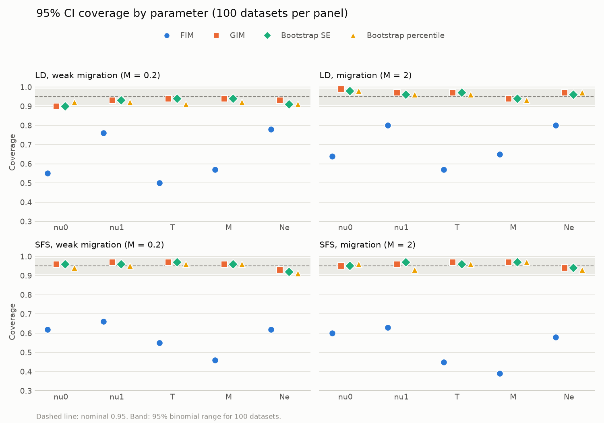
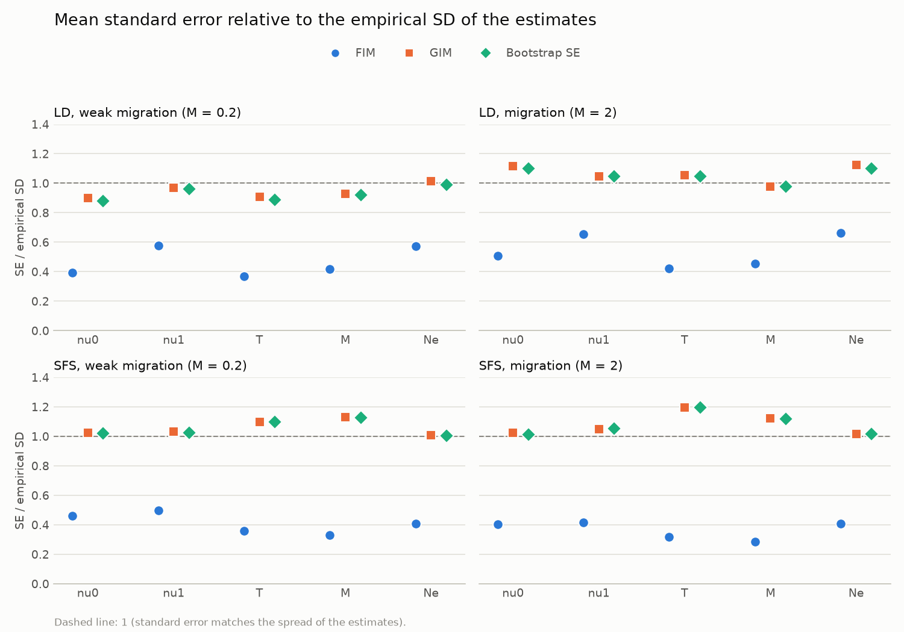

# Godambe / LRT calibration experiment: notes (updated 2026-11-12)

Status: the second CHTC run is complete (100 `mig`, 100 `weak`, 200 `null` datasets,
each analyzed with LD and with the SFS). Final results are in "Results". The adjusted
LRT method we propose (inverse blocks with centred J, with a fallback) is written up
in "The inverse-block LRT adjustment". Next: the write-up for others.

## Goal

Check, with msprime simulations run through the full workflow, that

- confidence intervals from FIM, GIM (linear and log scale) and bootstrap refits have
  the right coverage, for LD statistics and for the SFS, on the same simulated data;
- the adjusted likelihood ratio test for migration has the right false positive rate
  under the null, and see how much power it has.

## Files in this directory (all untracked)

| Path | What it is |
| --- | --- |
| `godambe_calibration.py` | The experiment. `run --scenario S --seed N` simulates one dataset and analyzes it with LD and SFS; `simulate` / `analyze --method {ld,sfs}` do the stages separately; `summarize` pools all results. The docstring has usage. |
| `plot_coverage.py` | Makes `figures/coverage.png` and `figures/sd_ratio.png` from `results/`. |
| `submit_replicates.sub` | HTCondor submit file: one job per row of the queue file (switch the `queue` line between `queue_test.csv` and `queue_inputs.csv`), 4 CPUs, 8 GB, returns `data/{S}_{N}.pkl` and `results/{ld,sfs}_{S}_{N}.pkl`. |
| `run_replicate.sh` | Job script: sets one thread, runs `run --scenario $1 --seed $2 --regions $3 --boot-refits $4 --procs $5` (`$5` = `request_cpus`). |
| `queue_inputs.csv` | Second run, `scenario, seed, regions, boot_refits`: mig 1–100, weak 1–100, null 1–200, all with 500 regions and 200 refits. |
| `queue_test.csv` | Cluster test: seeds 9001–9002 for each scenario, 40 regions, 20 refits. Seeds differ from the full run, so outputs don't collide; delete them before `summarize`. |
| `growth_asym_calibration.py` | Second model (draft, not yet run): deme1 grows, migration asymmetric, built with demes; four LRTs (asym, mig with q = 2, oneway, growth) and CIs. Simulates new datasets (`g_*` scenarios, stored compactly) and reanalyzes the second run's datasets. |
| `compact_data.py` | Shrinks the second run's dataset pickles (~30 MB → ~6.5 MB) by storing the SFS bootstraps projected to 40 haploids in float32. Lossy only for larger projections. |
| `run_growth.sh`, `submit_growth_new.sub`, `submit_growth_reanalyze.sub`, `submit_compact.sub`, `queue_growth_new.csv`, `queue_growth_reanalyze.csv` | CHTC files for the second model: new datasets (stage `run`); reanalysis of the second run's datasets, which also shrinks them (stage `analyze`); shrinking only (stage `compact`). |
| `results/` | Second-run results, one pickle per dataset and method. |
| `results_old/` | First-run results (superseded). |
| `figures/` | Plots used below. |
| `NOTES.md` | This file. |

Extra checks were run from scripts in the job scratch (`power.py`, `wald.py`,
`waldstat.py`, `fallback.py`, `schur.py`, `hesswarn.py`, `dig3.py`, `dig4.py`); the
numbers they gave are recorded below.

Related, outside this directory:
- `../../notes_ld-godambe-review-and-calibration-2026-11-09.md`: the write-up of the review
  and the semi-parametric study (also at https://claude.ai/artifact/SGedFtxeod2MZASHBAsrzS).

## Experiment design

- **Model:** IM. Ancestral Ne = 10,000; deme0 2,000; deme1 20,000; split 1,500
  generations ago; symmetric migration m. In genetic units (nu0, nu1, T, M, Ne) with
  M = 2 Ne m: (0.2, 2, 0.075, M, 10,000).
- **Scenarios / datasets:** `mig` M = 2 (m = 1e-4), 100 datasets; `weak` M = 0.2
  (m = 1e-5), 100 datasets; `null` M = 0, 200 datasets. Each dataset: 500 regions × 2 Mb,
  40 diploids per deme, u = 1.25e-8, r = 1e-8.
- **Simulation:** msprime with infinite-sites mutations (`discrete_genome=False`, as in
  the moments models), written to VCF with `position_transform="legacy"`.
- **Data per dataset:** parsed by `moments.LD.Parsing.compute_ld_statistics` (r bins as
  in the docs, 0 to 1e-3) and `moments.Spectrum.from_vcf` (polarized; msprime REF =
  ancestral). 500 bootstrap sets from seeded region resampling, shared by LD and SFS
  (LD sets built with `means_from_region_data`, as `get_bootstrap_sets` does
  internally; SFS sets are sums of the same regions' spectra).
- **Fits:** every fit runs `FIT_CHAIN` on the log scale: L-BFGS-B, then Nelder-Mead
  from its result, then Nelder-Mead from the best point perturbed by up to ~7% (kept
  only if better). Nested fit (M = 0); full fit started from the nested optimum with
  M0 in {0.01, 0.1, 0.5} and from the truth, best kept. D = 2 ΔLL.
- **LRT adjustments:** none; the library's `LRT_adjust`; submatrix with centred J;
  inverse blocks with centred J. H, J and the mean score cU are computed over all
  parameters at the nested fit, by finite differences (central, and second-order
  forward at M = 0, so M is never negative).
- **CIs (`mig`, `weak`):** FIM, GIM, GIM (log), and 200 bootstrap refits (`REFIT_CHAIN`:
  L-BFGS-B then Nelder-Mead, from the full fit), giving bootstrap-SE and percentile CIs.
- **SFS:** projected to 40 haploids per deme for inference. Theta by multinomial
  scaling, reported as Ne = theta / (4 u L_total). "M = 0" is evaluated at M = 1e-12
  (`M_FLOOR`; see "SFS likelihood jumps at M = 0"). SFS `GIM (log)` uses
  `moments.Godambe` with log=True, which still has the step-scaling problem (step =
  eps * log p); its intervals are for comparison only.

## Pilot (2026-11-09)

Environment: Python 3.13 venv with moments from branch `godambe_log_step`, msprime
1.4.5, scikit-allel 1.3.13, h5py, pandas, demes. (`bootstrap_data` needs at least as
many regions as statistics per bin, 15 for two populations, so the smallest pilot is 16
regions.)

| Stage | Pilot | Per unit | Full design (200 datasets × 500 regions) |
| --- | --- | --- | --- |
| simulate + parse | 16 regions: 224 s wall, 24 CPU-min on 8 cores | ~89 CPU-s per 2 Mb region | ~2,500 CPU-hours (~12 CPU-h per dataset) |
| analyze, LD | 53 s wall, 97 CPU-s (8 refits) | ~15 CPU-min per dataset with 100 refits (rough) | ~25 CPU-hours |
| analyze, SFS | 77 s wall, 159 CPU-s (8 refits) | ~25 CPU-min per dataset with 100 refits (rough) | ~40 CPU-hours |

Pilot timings: simulation and parsing dominate. Analysis timings are rough (fits and refits were not
timed separately). Disk: ~5.5 MB per dataset file (~1.1 GB for 200 datasets).

**Estimates for the current settings (2026-11-10)**, one dataset per job on one core,
500 bootstrap sets and 500 refits (rough: refit cost assumed equal to the pilot's
average optimization, ~7.5 CPU-s LD and ~12 CPU-s SFS; cluster cores may be slower).
The lower u and r should leave the parsing cost about the same: fewer SNPs, but wider
r bins in bp.

| Per dataset | `mig` / `weak` | `null` |
| --- | --- | --- |
| simulate + parse | ~12.5 h | ~12.5 h |
| analyze, LD | ~1 h | ~1 min (no refits) |
| analyze, SFS | ~1.7 h | ~1.5 min |

Totals: `mig` and `weak` ~760 CPU-h each, `null` ~1,250 CPU-h (almost all simulation),
~2,800 CPU-h overall. Requested wall time: ~24 h simulate, 2 h LD, 3–4 h SFS. Set
`OMP_NUM_THREADS=1` (and MKL/OpenBLAS equivalents). Disk: ~30 MB per dataset with 500
bootstrap sets (mostly SFS bootstraps), ~6 GB total.

The null datasets are what test the LRT false positive rate (the main open question);
100 gives a standard error of ~2.2 points at the 5% level. Option to get more from them:
evaluate the false positive rate on the first 100, 250 and all 500 regions.

## CHTC test run (2026-11-10)

6 jobs (2 per scenario, 40 regions, 20 refits, 1 CPU): all returned their files to
`data/` and `results/` (`preserve_relative_paths` works). CPU use ~0.98, memory ~1.1 GB,
disk ~620 MB (mostly the container image). Times on CHTC are ~2.5x the laptop pilot:

- simulate + parse: 189–243 s per region (mean 222), so ~31 h (up to 34 h) on one core
  for 500 regions;
- LD analysis: ~150 s without refits, ~20 s per refit (500 refits: ~2.8 h);
- SFS analysis: ~260 s without refits, ~39 s per refit (500 refits: ~5.5 h).

One core per job would be 31–39 h, so jobs now use `request_cpus = 4`, passed to
`--procs`: ~10 h per mig/weak job, ~8 h per null job. Total ~7,000 CPU-hours; with 200
refits instead of 500, ~6,500.

Memory: 4 GB was too little for 4 processes. Full-run jobs went over the cgroup limit,
because each worker process simulating and parsing a region needs about as much memory
as the whole 1-CPU test job (~1 GB), so the peak grows with the number of processes.
Request more than 1 GB per process plus the parent.

## Finding from the pilot: SFS likelihood jumps at M = 0

`Spectrum.integrate` uses `Integration_nomig.integrate_nomig` when all migration rates
are exactly 0, a different integrator from the one used for any M > 0. On the pilot
SFS (n = 40 per deme) at the nested fit:

    ll(M = 0)     = -4393.7040
    ll(M = 1e-12) = -4393.7291   (jump of 0.025)
    ll(M = 1e-6)  = -4393.7287   (smooth above 0: slope ~444)

- Finite differences that start at M = 0 cross the jump. In the pilot, H_MM came out
  negative for steps up to 3e-3. Starting at M = 1e-12, H_MM = 1166.6 for every step
  from 1e-4 to 1e-2.
- Library impact: `moments.Godambe.LRT_adjust` (SFS) differentiates from M = 0 with
  eps = 0.01, which puts an error of about 0.025 / 1e-4 = 250 into H_MM ≈ 1167
  (~20%). D is also shifted by ~0.05 (nested fit uses the other integrator).
  Probably also affects Demes SFS inference with zero migration. Worth its own issue,
  or adding to the LRT issue.
- The LD likelihood has no such jump (H_MM stable from step 1e-4 to 1e-2).

## The inverse-block LRT adjustment

This is the method we propose as an alternative to `moments.Godambe.LRT_adjust` and
`moments.LD.Godambe.LRT_adjust`. In the script it is `adjustment_inverse_blocks(...,
centre=True)`, with the fallback described below. The decision so far (2026-11-11) is
to offer it later as a separate function next to the existing `LRT_adjust`, not as a
replacement, after testing it on other models.

### Summary

    adj = q / tr[ (H^ψψ)⁻¹ G^ψψ ]

with H^ψψ and G^ψψ the ψψ blocks of H⁻¹ and of H⁻¹ J H⁻¹, all computed over **all**
parameters at the nested fit, and J the **centred** variance of the bootstrap scores.
Compare adj · D with χ²_q, or with ½χ²₀ + ½χ²₁ for one parameter on a boundary. If the
Hessian of the full model at the nested fit is ill-conditioned in the ψ direction,
fall back to the submatrix formula with centred J, and warn.

In this experiment (one IM model, testing for migration) it is the only adjustment
that is calibrated under the null (LD .06, SFS .04 at α = .05), and with the fallback
it has power ≥ .97 at α = .01 in every scenario. The library's `LRT_adjust` is valid
but very conservative (null .01 at α = .05; power at α = .01 of .45 in LD `weak` and
.00 in both SFS scenarios).

### Notation

- θ = (ψ, τ): ψ are the q parameters fixed by the nested model (here ψ = M, q = 1, fixed
  at 0), and τ are the other parameters (nu0, nu1, T, and Ne or theta), which are refit
  in both models.
- cℓ(θ): the composite log-likelihood. The LD and SFS likelihoods both treat linked
  data as independent (LD: all bins and regions; SFS: all sites).
- U = ∇cℓ: the score. H = −∇²cℓ: the sensitivity matrix (curvature).
  J = Var(U): the variability matrix (the variance of the score between datasets).
- θ̃ = (ψ₀, τ̃): the nested fit. θ̂: the full fit. D = 2 [cℓ(θ̂) − cℓ(θ̃)].
- Blocks: H_ψψ, H_ψτ, ... are submatrices of H; H^ψψ = (H⁻¹)_ψψ is a block of the
  inverse; G = H⁻¹ J H⁻¹ is the Godambe (sandwich) variance of θ̂, and G^ψψ its ψψ block.

### Theory

For a composite likelihood, θ̂ is asymptotically normal with variance G = H⁻¹ J H⁻¹
(Godambe 1960), not H⁻¹, because the information identity H = J fails when the pieces
of data are dependent. Under the null, the LRT statistic is then not χ²_q but a
weighted sum (Kent 1982; Varin, Reid & Firth 2011, §2.3):

    D  →  Σⱼ λⱼ Zⱼ²,    Zⱼ ~ N(0, 1) independent,
    λⱼ = eigenvalues of (H^ψψ)⁻¹ G^ψψ.

Dividing D by the mean eigenvalue λ̄ = tr[(H^ψψ)⁻¹ G^ψψ] / q matches the first moment
of χ²_q (Rotnitzky & Jewell 1990; Geys, Molenberghs & Ryan 1999). For q = 1 there is
one eigenvalue and the match is exact asymptotically: adj = H^ψψ / G^ψψ. For q > 1 it
is approximate; a second-moment (Satterthwaite) version also changes the degrees of
freedom, or the weighted-χ² distribution can be used directly.

On a boundary (M ≥ 0, ψ₀ = 0, q = 1), the unadjusted D is a mixture ½χ²₀ + ½λχ²₁
(Self & Liang 1987, with the composite-likelihood scaling), so adj · D is compared with
½χ²₀ + ½χ²₁. With several boundary parameters the mixture weights depend on G and are
not ½ (chi-bar-squared), which a general implementation would need to handle.

Equivalent form, which is how to compute and think about it for q = 1:

    S  = H_ψψ − H_ψτ H_ττ⁻¹ H_τψ          (Schur complement = (H^ψψ)⁻¹)
    U* = U_ψ − H_ψτ H_ττ⁻¹ U_τ            (efficient score for ψ)
    adj = S / Var(U*)

because the ψ rows of H⁻¹ are H^ψψ [I, −H_ψτ H_ττ⁻¹], so G^ψψ = H^ψψ Var(U*) H^ψψ.
The adjustment is invariant to reparameterising τ and to rescaling ψ, so τ can be
handled on whatever scale is convenient.

### Intuition

1. **Why an adjustment is needed.** A composite likelihood of linked data counts each
   correlated piece of data as independent evidence. Its surface is too sharply peaked
   for how much the estimates actually vary between datasets, so D is inflated by a
   factor λ. Unadjusted, the test rejects a true null 24–28% of the time at α = .05
   here.

2. **λ is the GIM-to-FIM variance ratio.** For q = 1, D ≈ (ψ̂ − ψ₀)² / H^ψψ. The
   numerator varies across datasets with the true variance of ψ̂, G^ψψ (the GIM
   variance); the denominator is the variance the curvature claims, H^ψψ (the FIM
   variance). So λ = (SD_GIM(ψ) / SD_FIM(ψ))² and adj = 1/λ. **The LRT adjustment is
   the same correction as using GIM instead of FIM for the uncertainty of M**, applied
   to the test. In the CI results below, FIM SEs for M are 0.28–0.45 of the true spread;
   the median adj under the null is 0.21 (LD) and 0.11 (SFS), i.e. SD_FIM / SD_GIM
   ≈ 0.46 and 0.33, the same order.

3. **Why inverse blocks, not submatrices.** The current `LRT_adjust` uses
   q / tr(J_ψψ H_ψψ⁻¹): it asks how inflated the score for M is **with the other
   parameters held fixed**. But D is a profile statistic: as M moves, T and the sizes
   are refit and absorb part of the signal (M and T are strongly correlated). What
   matters is the part of the M score the other parameters cannot absorb, the efficient
   score U*, with curvature S. Only S / H_MM of the curvature survives that refitting:
   0.10–0.16 for LD and 0.26–0.30 for the SFS here. The submatrix formula is right only
   when H_ψτ = 0. Here the inverse-block adj is a median 1.8× (SFS) to 2.1× (LD) the
   submatrix adj under the null, and the submatrix test is conservative (LD .01 at α = .05).

4. **Why J must be centred.** J should be the variance of the score: its noise. The
   bootstrap scores, evaluated at the nested fit, average to roughly the observed
   score there. For τ that is zero (the nested fit maximizes over τ), but for M it is
   the slope of the likelihood in M at M = 0, which is **the evidence for migration the
   test is trying to detect**. The uncentred mean(U Uᵀ) = Var(U) + cU cUᵀ counts that
   signal as noise, so adj shrinks as the evidence grows, roughly as 1/D. This is why
   the library's `LRT_adjust` caps adj · D in a narrow band (SFS 3.7–5.4, LD 1.1–17.5)
   whatever D is, and why the SFS test with D ≈ 25,000 still gives p ≈ 0.01. It also
   makes the test conservative under the null, since about half of null datasets have
   a positive slope at M = 0. (Same cause: `score_stat` with uncentred J is always
   below 1.)

5. **Both changes are needed.** Centring alone (submatrix, centred J) is still
   conservative under the null (LD .01 at α = .05) and loses power (LD `weak` .76 at
   α = .01); inverse blocks with an uncentred J stayed conservative in the
   semi-parametric study.

### When it breaks: an ill-conditioned H at the nested fit, and the fallback

The theory assumes the nested fit is close to the full fit (the null, or local
alternatives), so that one quadratic approximation describes the likelihood around both.
When the nested model is badly wrong, that fails.

- **What happens.** In LD `mig` (M = 2, D ≈ 2,600–4,300), the Schur complement S is
  essentially zero: S / H_MM is −0.016 to 0.011, against ≥ 0.079 in every other
  scenario. H_ττ is positive definite in every dataset (the nested fit maximizes over
  τ), so the trouble is entirely in the profiled M direction: once T and the sizes are
  refit, the log-likelihood is flat, or even convex, in M at M = 0. In 54 of 100 datasets
  S < 0, H is indefinite, and the inverse-block adj is negative (p = 1); in the rest it
  is positive but meaningless (adj · D from 0.7 to 52 when D ≈ 3,400). Power at
  α = .01 is .41.
- **Why it is not a problem for the theory.** Under a fixed alternative D grows with
  the data, so any reasonable positive adj rejects. The adjustment only needs to be
  sensible; it does not need to be accurate there.
- **Why the submatrix is a safe fallback.** The submatrix formula needs only
  H_MM > 0, the curvature in M with τ held fixed, which stays positive. It ignores the
  profiling, so it is conservative when M and τ are correlated, but with D in the
  thousands it still rejects (power 1.00 in LD `mig` with centred J).
- **Fallback rules compared** (inverse blocks, centred J, falling back to the
  submatrix with centred J; power at α = .01 / .05 / .10 in LD `mig`; no other
  scenario changes under any rule, including the null):

  | Fall back when | LD `mig` power | Comment |
  | --- | --- | --- |
  | adj ≤ 0 | .95 / .97 / .97 | misses datasets with a tiny positive adj |
  | smallest eigenvalue of correlation-scaled H < 0.005 | 1 / 1 / 1 | the rule used by the new library warning; other scenarios ≥ 0.016 (3× margin) |
  | S / H_MM < ~0.03 | 1 / 1 / 1 | other scenarios ≥ 0.079 (7× margin); measures the profiled M curvature directly |
  | adj_ib < adj_sub | 1 / 1 / 1 | also falls back in all SFS `mig` datasets (ratio 0.73), harmlessly here; not principled, since the submatrix adj can be too large in other models |

  **Recommendation:** fall back on the curvature ratio S / H_ψψ (for q > 1, the
  smallest eigenvalue of H_ψψ^(−1/2) S H_ψψ^(−1/2)), with a threshold to be set on
  other models, and always warn when it triggers. It is the quantity that actually
  goes wrong, it separates the cases with a wide margin here, and it is cheap. The
  correlation-scaled eigenvalue rule (used by the warning now in the library) is a
  reasonable proxy.
- **Untested alternative:** evaluate H and J at the full fit instead, where H is
  positive definite (it is a maximum). This is asymptotically equivalent under the null
  and local alternatives, but needs a second set of bootstrap scores.

### Practical implementation

- **Inputs.** The full model function, the nested fit given as full-model parameters
  with ψ at its fixed value, the data, the bootstrap replicates (the same ones as for
  GIM), and the indices of ψ. Use the nested fit, not the full fit, for H, J and cU.
- **Compute over all parameters.** H, the bootstrap scores, cU and J over all k
  parameters, including theta (SFS, multinomial) or Ne (LD), which are nuisance
  parameters like any other τ.
- **Centre J:** J = mean(U Uᵀ) − cU cUᵀ, i.e. the sample covariance of the bootstrap
  scores.
- **Compute the Schur form, not explicit inverses:** S and Var(U*) via solves with
  H_ττ (positive definite at the nested fit), then adj = q / tr(S⁻¹ Var(U*)). The
  conditioning check S / H_ψψ comes for free.
- **Finite differences at a boundary:** ψ₀ = 0 is the edge of the parameter space.
  Use forward differences in ψ so the model is never evaluated at negative migration;
  second-order forward differences matched central ones to ~1e-6 for LD here (the
  library's `get_hess` uses first-order forward steps of absolute size `eps` for
  parameters equal to zero).
- **SFS integrator jump at M = 0:** `Spectrum.integrate` switches integrators when all
  migration rates are exactly 0, which puts a jump of ~0.025 log-likelihood units at
  M = 0 and an error of ~20% into H_MM. Evaluate the nested model at a tiny positive M
  (1e-12 here), both for the nested fit and the derivatives. LD has no jump.
- **Fits must be converged.** D, the nested fit (where the scores are evaluated) and
  the full fit all need to be at their optima: the full fit started from the nested
  optimum and a few M values, and L-BFGS-B followed by Nelder-Mead. Under-converged
  refits caused the too-narrow LD bootstrap in the first run.
- **Cost.** One Hessian over all k parameters (about 2k² + 1 model evaluations) plus
  the bootstrap gradients, which reuse the same 2k model evaluations for every
  replicate (the model does not depend on the data). The existing `LRT_adjust`
  differentiates only in ψ (about 3 evaluations for q = 1), so the new method costs
  about as much as one `GIM_uncert` call.
- **Number of bootstrap replicates.** For q = 1 adj depends on the single variance
  Var(U*), whose relative error is about √(2/B): ~6% for B = 500, ~14% for B = 100.
- **Report:** adj, adj · D, the p-value, whether the fallback was used, and the
  conditioning value.
- **Open questions for the library version:** the fallback threshold on other models
  (more parameters, more populations, pulses, size changes); q > 1 (second-moment
  correction, chi-bar-squared weights on boundaries); whether to offer H and J at the
  full fit; and checking that the one-sided Wald test from GIM at the full fit is
  calibrated (the null jobs did not compute a full-fit GIM).

## Run history

- **First run (2026-11-11, superseded; outputs in `results_old/`).** 50 `mig`,
  50 `weak`, 100 `null` datasets, finite-sites mutations, one L-BFGS-B per full fit and
  refit, 500 refits. It showed the same LRT picture as the final run, plus three
  problems: SFS fits biased by ~1 SD for Ne and nu0, an LD `weak` bootstrap that was too
  narrow (coverage of M 0.62), and negative inverse-block adjustments in LD `mig`.
- **Second run (this one).** Rerun from scratch with infinite-sites mutations, the
  chained optimizers (`FIT_CHAIN`, `REFIT_CHAIN`), twice the datasets and 200 refits.
  Smoke tests before submitting showed L-BFGS-B alone stops well short, especially for
  LD (Nelder-Mead after it gained 16–336 log-likelihood units on LD full fits, median 7
  on refits), and that a third step (Powell, or the perturbed Nelder-Mead) gains nothing
  more, so it serves as a convergence check. The first two problems are gone in the
  second run (below); the third is a property of the method, described above.

## Results (second run, final, 2026-11-12)

All 400 datasets per method are in (100 `mig`, 100 `weak`, 200 `null`). Tables from
`python godambe_calibration.py summarize`, figures from `plot_coverage.py`.

### Confidence intervals

95% CI coverage (100 datasets; ±~0.04):

| | FIM | GIM | Bootstrap SE | Bootstrap percentile |
| --- | --- | --- | --- | --- |
| LD `mig` | .57–.80 | .94–.99 | .94–.98 | .93–.98 |
| LD `weak` | .50–.78 | .90–.94 | .90–.94 | .91–.92 |
| SFS `mig` | .39–.63 | .94–.97 | .94–.97 | .93–.97 |
| SFS `weak` | .46–.66 | .93–.97 | .92–.97 | .91–.96 |

- **FIM undercovers badly** (as low as .39 for M in SFS `mig`): its SEs are 0.28–0.66
  of the spread of the estimates. This is the composite-likelihood overconfidence that
  the GIM and the LRT adjustment correct.
- **GIM and the bootstrap agree closely** for every parameter (SEs within ~2% of each
  other), and are within about 10–20% of the empirical SD: slightly narrow in LD `weak`
  (0.90–0.97, except Ne 1.01), slightly wide in SFS and LD `mig` (up to 1.20 for SFS
  `mig` T). Coverage is .90–.99. The lowest is LD `weak` nu0 (.90; GIM SD 10% below the
  empirical SD).
- **So the Godambe approach gives what the bootstrap refits give**, at the cost of one
  Hessian and the bootstrap scores instead of one optimization per replicate.
- GIM (log) is close to GIM for LD (M in LD `weak`: .90 against .94); for the SFS it is 1.00 for most parameters (too wide,
  from the step-size problem with `log=True` in `moments.Godambe`).
- Bias of the full-fit estimates is at most 0.18 SD (LD `mig` M). The first run's SFS
  bias is gone.

### LRT under the null

Fraction of p < α = .01 / .05 / .10 / .25 (200 datasets; ±~0.015 at α = .05):

| Adjustment | LD | SFS |
| --- | --- | --- |
| None | .15 / .24 / .27 / .35 | .24 / .28 / .35 / .42 |
| `LRT_adjust` (library) | .00 / .01 / .04 / .18 | .00 / .01 / .04 / .20 |
| Submatrix, centred J | .00 / .01 / .04 / .18 | .01 / .02 / .04 / .20 |
| **Inverse blocks, centred J** | .01 / .06 / .10 / .26 | .01 / .04 / .10 / .25 |
| `moments.Godambe.Wald_stat`* | .11 / .20 / .27 / – | .01 / .10 / .17 / – |

About half the null datasets have D ≈ 0 (55% LD, 51% SFS have D < 1e-3), as expected
on the boundary. The fallback never triggers under the null, so it does not change
these rates. *`Wald_stat` computed from the stored nested-fit H and J (GIM over M only,
uncentred J): it rejects a true null far too often.

### Power

Fraction of p < α = .001 / .01 / .05 / .10 (100 datasets each):

| Adjustment | LD `weak` | LD `mig` | SFS `weak` | SFS `mig` |
| --- | --- | --- | --- | --- |
| None | .99 / 1 / 1 / 1 | 1 / 1 / 1 / 1 | 1 / 1 / 1 / 1 | 1 / 1 / 1 / 1 |
| `LRT_adjust` | .00 / .45 / .94 / .98 | 1 / 1 / 1 / 1 | .00 / .00 / 1 / 1 | .00 / .00 / 1 / 1 |
| Submatrix, centred J | .44 / .76 / .97 / .98 | 1 / 1 / 1 / 1 | 1 / 1 / 1 / 1 | 1 / 1 / 1 / 1 |
| Inverse blocks, centred J | .78 / .97 / .99 / 1 | .35 / .41 / .43 / .43 | 1 / 1 / 1 / 1 | 1 / 1 / 1 / 1 |
| **Inverse blocks + fallback** (conditioning rule) | .78 / .97 / .99 / 1 | 1 / 1 / 1 / 1 | 1 / 1 / 1 / 1 | 1 / 1 / 1 / 1 |

Median adj · D (`LRT_adjust` / submatrix / inverse blocks): LD `weak` 5.3 / 9.0 / 15.5
(median D 90); SFS `weak` 3.9 / 39 / 63 (D 807); LD `mig` 13.6 / 341 / −2.5 (D 3,430);
SFS `mig` 5.2 / 747 / 552 (D 25,470).

For comparison, the one-sided Wald test of M with the GIM SE at the full fit rejects
at α = .01 / .05 in .97 / .99 of LD `weak` datasets and 1 / 1 elsewhere, and the
bootstrap refits (fraction of M* ≤ 0 below α) in .94 / .98 and 1 / 1; their false
positive rates were not measured (the null jobs have no full-fit GIM or refits).

### The new library warning

The `LRT_adjust` warning added on `devel` (smallest eigenvalue of the correlation-scaled
H at the nested fit < 0.005) fires on 100/100 LD `mig` datasets and on none of the
other 700. Smallest eigenvalue: LD `mig` −0.004 to 0.003; LD `null`/`weak` and SFS
`mig` ≥ 0.016; SFS `null`/`weak` ≥ 0.051.

### Convergence

- Final log-likelihood across the 4 full-fit starts: median spread < 1e-4; > 0.1 in
  only 5 LD `weak`, 5 LD `null` and 7 SFS `null` datasets (max 0.56; the best start is
  used).
- The perturbed Nelder-Mead step never gained more than 0.01 on any full or nested fit.
- Nelder-Mead after L-BFGS-B in the refits: median gain 0.35 (LD `mig`) to 2.6 (SFS
  `weak`), max 68. L-BFGS-B alone is not enough for the refits.

## Next steps

1. Write up the experiment and the method for others (from this file).
2. Library, later version (decided 2026-11-11): add the inverse-block adjustment as a
   separate function next to the existing `LRT_adjust` (not a replacement), in both
   `moments.Godambe` and `moments.LD.Godambe`, as specified in "Practical
   implementation" above. First test it on other demographic models, which will also
   set the fallback threshold.
3. Optional extra run: add a full-model fit with GIM SEs to the null jobs, to check the
   false positive rate of the one-sided Wald test that the docs now suggest.
4. Done in this round: the `LRT_adjust` Hessian warning and the docs note on
   conservative LRTs with alternatives (PR from `lrt_hessian_warning` into `devel`).

## Related open items

- Issues to open or already drafted: J centring (also makes `score_stat` < 1 always);
  LRT too conservative (method fix: inverse blocks + centred J; Varin, Reid & Firth
  2011 §2.3; Chandler & Bate 2007 as an alternative); log=True step size (fixed on
  `godambe_log_step`).
- To come back to: unit tests that `moments.Demes.Inference` (optimize/optimize_LD,
  uncerts/uncerts_LD) matches `Inference`/`Godambe` for split_mig after converting
  physical <-> genetic units (fits to ~1e-4, SEs via the delta method to ~1e-3,
  log=False and log=True). Prototype first to measure the tolerances.
- h2py (`nwcol/h2py`, `h2py/uncerts.py`): `compute_lrt_adjustment` uses `inv(HH)` with
  HH the Hessian of +LL, so the factor is negative (fix: `inv(-HH)`); global model cache
  keyed only by parameters. The user is telling the author.
