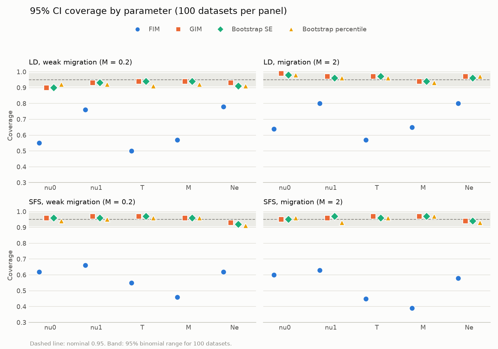
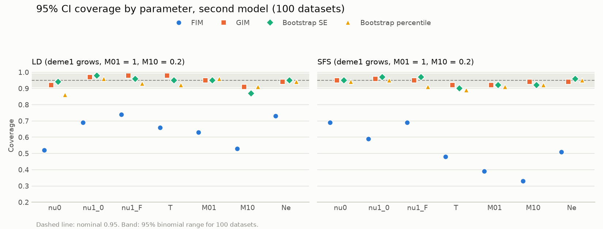

# Calibrating Godambe uncertainties and LRT adjustments in moments

2026-11-14 · Shared version: https://claude.ai/artifact/3uooqPD2b3RnNeTPUStekv

## Summary

Godambe (GIM) uncertainties in moments are well calibrated for both LD statistics and the SFS, but the existing likelihood ratio test adjustment, `LRT_adjust`, is far too conservative; an adjustment built from the inverse blocks of the Godambe matrices, with a centred variability matrix, is calibrated and has full power in both simulation models.

- **Confidence intervals.** GIM and bootstrap-refit intervals cover the truth 86–99% of the time for every parameter of both models (nominal 95%). FIM intervals cover only 30–81%: the composite likelihoods of linked data are overconfident by a factor of 2–4 in standard error.
- **LRT, existing method.** `LRT_adjust` almost never rejects a true null (good), but it also misses real signal: with weak migration in the first model it rejected at the 1% level in 0% (SFS) and 45% (LD) of datasets, and in the second model's symmetric-vs-asymmetric migration test it had 0% power at the 5% level even with D in the thousands.
- **LRT, proposed method.** Inverse blocks of H⁻¹ and H⁻¹JH⁻¹ over all parameters, with J centred, gives false-positive rates at nominal levels in all six tests across the two models (interior and boundary, one and two parameters), agrees closely with a Monte Carlo null distribution, and has power near 100% wherever the data carry the signal.
- **When it breaks.** If the nested model fits very badly, the Hessian at the nested fit can be indefinite, and the adjustment is meaningless (first model, strong migration). Fixed thresholds on how ill-conditioned the Hessian is do not transfer between models, so the fallback rule needs more work.
- **Wald test.** A one-sided Wald test from GIM standard errors at the full fit is roughly calibrated (3–8% false positives at the 5% level) and a reasonable alternative today.

Decisions: for moments 1.7.1, `LRT_adjust` warns only when that Hessian is indefinite, and the docs describe the conservativeness and alternatives. The inverse-block adjustment is planned as a separate function in a later release; the fallback rule will be developed outside moments first.

## Background and goals

Both moments likelihoods are composite likelihoods: the LD likelihood treats recombination bins and regions as independent, and the SFS likelihood treats all sites as independent, although linked data are correlated. The likelihood surface is then too sharply peaked for how much estimates really vary between datasets.

- **Uncertainty.** The Fisher information (FIM, from the curvature H) understates uncertainty. The Godambe information (GIM, H J⁻¹ H, with J the variance of the score estimated from bootstrap replicates over regions) corrects this (Coffman et al. 2016). Bootstrap refits of the model are the expensive reference.
- **Model comparison.** The likelihood ratio statistic D = 2 (ℓ_complex − ℓ_simple) is inflated by the same overconfidence, so it must be scaled down before comparing with χ². moments' `LRT_adjust` (SFS and LD) does this by first-order moment matching.

We checked, with msprime simulations run through the full moments workflow (simulate, parse, fit), whether these intervals cover the truth at their nominal rate, whether the adjusted LRT has the right false-positive rate, and how much power it has, for LD statistics and the SFS on the same simulated data.

## Simulation design

Each dataset is 500 independent 2 Mb regions simulated with msprime (infinite sites, u = 1.25e-8, r = 1e-8), 40 diploids sampled per deme, parsed into LD statistics (`moments.LD.Parsing`) and a joint SFS (projected to 40 haploids per deme). LD and SFS analyses share the same data and the same 500 bootstrap replicates (regions resampled with replacement).

| | First model: split with migration | Second model: growth and asymmetric migration |
| --- | --- | --- |
| Demography | Ne 10,000 splits 1,500 generations ago into deme0 (2,000) and deme1 (20,000); symmetric migration M = 2 Ne m | Same split; deme1 grows exponentially from 2,000 to 20,000; migration M01 (deme0 to deme1) and M10 (deme1 to deme0) separately |
| Parameters | nu0, nu1, T, M, Ne (5) | nu0, nu1_0, nu1_F, T, M01, M10, Ne (7) |
| Model functions | `split_mig` (SFS and LD) | built with demes in the experiment script |
| Scenarios (datasets) | `mig` M = 2 (100), `weak` M = 0.2 (100), `null` M = 0 (200) | `g_nomig` (100), `g_sym` M01 = M10 = 1 (100), `g_oneway` M01 = 1, M10 = 0 (100), `g_asym` M01 = 1, M10 = 0.2 (100); plus the first model's 400 datasets reanalyzed |
| Tests | migration: M = 0 (boundary) | asym: M01 = M10 (interior); mig: M01 = M10 = 0 (two parameters, boundary); oneway: M10 = 0 (boundary); growth: nu1_F = nu1_0 (interior) |
| Bootstrap refits | 200 per dataset (`mig`, `weak`) | 100 per dataset (`g_asym`) |

Fits are chained (L-BFGS-B, then Nelder-Mead, then Nelder-Mead from a perturbed start for the main fits), and the full model is started from the nested optimum and from the truth; in both runs the final perturbed step never gained more than 0.01 log-likelihood units. Second-model migration rates are bounded below at 1e-8. The SFS model is evaluated at a tiny positive migration rate instead of exactly zero, to avoid an integrator switch (moments issue #292, fixed for 1.7.1).

## Methods compared

The proposed LRT adjustment differs from `LRT_adjust` in two ways, both needed: it uses inverse blocks over all parameters, and it centres J. Notation: ψ are the q parameters the nested model fixes, τ the rest; H is the curvature (negative Hessian), J the variance of the score, both over all parameters at the nested fit.

```latex
\mathrm{adj} = \frac{q}{\operatorname{tr}\left[ (H^{\psi\psi})^{-1} G^{\psi\psi} \right]}, \qquad H^{\psi\psi} = (H^{-1})_{\psi\psi}, \quad G^{\psi\psi} = (H^{-1} J H^{-1})_{\psi\psi}, \quad J = \overline{U U^\top} - \bar U \bar U^\top
```

adj × D is compared with χ²_q, or the corresponding χ² mixture on a boundary (½χ²₀ + ½χ²₁ for one parameter; ¼, ½, ¼ for two). This is first-order moment matching of the composite-likelihood ratio statistic (Varin, Reid and Firth 2011), exact asymptotically for q = 1.

| Method | Uses | Why it matters |
| --- | --- | --- |
| None | D against χ² | ignores the overconfidence |
| `LRT_adjust` (moments) | submatrices H_ψψ and J_ψψ, J not centred | ignores that τ is refit when ψ moves; counts the signal as noise |
| Submatrix, centred J | submatrices, J centred | fixes the noise term only |
| Inverse blocks, centred J | the formula above | profiles over τ (Schur complement); J measures noise only |
| Monte Carlo (second model) | simulates D's asymptotic null, Σ λⱼ Zⱼ² (with the boundary), from the estimated H and J | checks whether first-moment matching is enough |
| One-sided Wald | z = M̂ / SE_GIM at the full fit | the alternative the docs now suggest |

Intuition: the adjustment equals (SD_FIM / SD_GIM)² for the tested parameter, the same correction GIM makes to its standard error. Without centring, the mean bootstrap score at the nested fit (which is the evidence for the alternative) inflates J, so the adjustment shrinks roughly as 1/D and the adjusted statistic stays small however strong the signal.

## Results: first model (split with migration)

GIM and bootstrap intervals are calibrated, and inverse blocks with centred J are the only adjustment calibrated under the null; `LRT_adjust` is valid but caps the evidence.

**Confidence intervals** (`mig` and `weak`, 100 datasets each). GIM coverage was 0.90–0.99 and bootstrap intervals matched GIM to within about 2% in standard error. FIM covered 0.39–0.81, with standard errors 0.28–0.66 of the true spread. Bias was at most 0.18 SD.



**LRT under the null** (200 datasets; fraction of p-values below α = .01 / .05 / .10):

| Adjustment | LD | SFS |
| --- | --- | --- |
| None | .15 / .24 / .27 | .24 / .28 / .35 |
| `LRT_adjust` | .00 / .01 / .04 | .00 / .01 / .04 |
| Submatrix, centred J | .00 / .01 / .04 | .01 / .02 / .04 |
| Inverse blocks, centred J | .01 / .06 / .10 | .01 / .04 / .10 |
| `moments.Godambe.Wald_stat` | .11 / .20 / .27 | .01 / .10 / .17 |

**Power** (100 datasets; rejection at α = .01):

| Adjustment | LD `weak` | LD `mig` | SFS `weak` | SFS `mig` |
| --- | --- | --- | --- | --- |
| `LRT_adjust` | .45 | 1.00 | .00 | .00 |
| Submatrix, centred J | .76 | 1.00 | 1.00 | 1.00 |
| Inverse blocks, centred J | .97 | .41 | 1.00 | 1.00 |
| Inverse blocks, falling back when H is ill-conditioned | .97 | 1.00 | 1.00 | 1.00 |

`LRT_adjust` turned D ≈ 25,000 (SFS `mig`) into an adjusted statistic of about 5, so p ≈ 0.01 and never below. The inverse-block failure in LD `mig` is the indefinite-Hessian case described under Conditioning below. The existing `Wald_stat` (GIM over the nested parameter at the nested fit) rejects a true null far too often and is not recommended.

## Results: second model (growth and asymmetric migration)

In all four tests, inverse blocks with centred J are calibrated and the Monte Carlo null agrees with them almost exactly; `LRT_adjust` has no power at all in the interior asymmetry test.

**LRT under a true null** (100–200 datasets per scenario; fraction below α = .01 / .05 / .10, ranges over LD and SFS and the scenarios where the null holds):

| Test (scenarios) | `LRT_adjust` | Inverse blocks, centred J | Monte Carlo |
| --- | --- | --- | --- |
| asym, interior (`g_sym`, `mig`, `weak`) | .00 / .00 / .00–.03 | .00–.03 / .04–.07 / .06–.12 | the same as inverse blocks |
| mig, two parameters on the boundary (`g_nomig`, `null`) | .00 / .00–.01 / .01–.04 | .00–.02 / .03–.07 / .07–.11 | .00–.01 / .01–.05 / .09–.10 |
| oneway, boundary (`g_nomig`, `g_oneway`, `null`) | .00 / .00–.02 / .01–.07 | .00–.02 / .04–.07 / .09–.13 | the same as inverse blocks |
| growth, interior (`mig`, `weak`, `null`) | .00–.01 / .00–.02 / .01–.06 | .00–.02 / .02–.09 / .09–.12 | the same as inverse blocks |

For the two-parameter test, fixed mixture weights ¼, ½, ¼ were closest to nominal; weights from the GIM correlation of the two estimates were slightly conservative.

**Power** (100 datasets; rejection at α = .05):

| Test (scenario) | `LRT_adjust` LD / SFS | Inverse blocks LD / SFS |
| --- | --- | --- |
| asym (`g_asym`: M01 = 1 vs M10 = 0.2) | .00 / .00 | 1.00 / 1.00 |
| asym (`g_oneway`) | .00 / .00 | .99 / 1.00 |
| oneway (`g_asym`: M10 = 0.2 vs 0) | .29 / .07 | .60 / 1.00 |
| mig (`weak`: M = 0.2) | .70 / 1.00 | .95 / 1.00 |

In the asymmetry rows D had medians of 530–820 (LD) and 4,700–8,000 (SFS), yet `LRT_adjust`'s p-value stayed near 0.2: in an interior test its cap on the adjusted statistic is much lower than on a boundary.

**Confidence intervals** (`g_asym`, all 7 parameters, 100 refits per dataset). GIM coverage 0.91–0.98 (LD) and 0.92–0.96 (SFS); bootstrap-SE 0.87–0.98 and percentile 0.86–0.96; FIM 0.52–0.74 (LD) and 0.33–0.69 (SFS). GIM standard errors were 0.87–1.15 of the true spread, FIM 0.23–0.57. No refits failed. In the other scenarios with all parameters away from zero, GIM covered 0.92–1.00.



**One-sided Wald test** of a migration rate, z = M̂ / SE_GIM at the full fit: with the rate truly zero it rejected .00–.03 / .03–.08 / .09–.14 at α = .01 / .05 / .10 (slightly liberal at .10). Its power matched the inverse-block LRT (LD oneway in `g_asym`: .61 against .60 at .05).

## Conditioning, warnings and fallbacks

The adjustment fails only when the Hessian at the nested fit is indefinite, and a small-but-positive curvature is not a reliable warning sign: thresholds tuned on one model misfire on the other.

- **The failure.** Under strong migration in the first model (LD `mig`, D ≈ 3,400), the nested model fits so badly that, after refitting the other parameters, the likelihood is flat or convex in M at M = 0. The Schur complement S = H_ψψ − H_ψτ H_ττ⁻¹ H_τψ is near zero or negative, H is indefinite in 54 of 100 datasets, and the inverse-block adjustment is negative or meaningless. With D that large, any sensible positive adjustment rejects, so falling back to the submatrix restores power.
- **Thresholds don't transfer.** The ratio S / H_ψψ was −0.016 to 0.011 in that failing case, but 0.006 to 0.015 in every dataset of the second model's growth test, where growth, size and timing are confounded and inverse blocks are nonetheless calibrated. A fallback at S / H_ψψ < 0.03 (chosen on the first model) fired on 100% of growth tests and made them conservative. The library warning's first threshold (scaled eigenvalue < 0.005) likewise fired on almost every growth test, including true nulls.
- **Degenerate tests.** Testing M01 = M10 on data without migration is not a regular problem: the asymmetry is undefined at M = 0. S is then hugely negative, inverse blocks give p = 1, `LRT_adjust` rejects 6–11% and the threshold fallback 20–31%. Such tests should be flagged, not adjusted.
- **What the warning does now** (moments 1.7.1): warn only if H is indefinite or has non-positive or non-finite diagonal entries. On the second model's results that rule never fires on the growth test, and fires on 59–84% of the degenerate asymmetry tests, 1–2% of strong alternatives, and 9% of LD `weak` asymmetry tests (M = 0.2, where the asymmetry is nearly undefined).

## Conclusions and next steps

Use GIM (or bootstrap) intervals, never FIM; treat a non-significant `LRT_adjust` result with a large D as inconclusive; and implement the inverse-block adjustment in a later release.

**Changes in moments 1.7.1** (on `devel`):

- `LRT_adjust` (SFS and LD) checks the Hessian of the complex model at the nested fit and warns if it is indefinite or has non-positive diagonal entries (opt out with `check_hessian=False`). The adjustment itself is unchanged.
- The LD inference docs explain that `LRT_adjust` can be very conservative and give three alternatives: a one-sided Wald test from GIM standard errors (shown here to be roughly calibrated), refitting the complex model to bootstrap replicates, and a parametric bootstrap under the simple model.
- `Spectrum.integrate` uses the migration integrators whenever a migration matrix is given, removing the jump in the SFS likelihood at zero migration (#292) that broke finite differences at the boundary.

**Future work:**

1. Add the inverse-block adjustment with centred J as a separate function next to `LRT_adjust`, in `moments.Godambe` and `moments.LD.Godambe`. Not for 1.7.1.
2. Rework the guard for non-regular cases: fall back only when H is indefinite, and flag tests whose parameter is undefined under the null, rather than using a curvature threshold.
3. Develop and calibrate the guard outside moments first, possibly as a separate package built on moments, so that moments' code and release history don't change back and forth during validation.
4. Note an issue (drafted, not yet opened): `LRT_adjust` is too conservative, with almost no power for interior parameters.

## Reproducing

Everything is in `examples/LD_Godambe_calibration/` on the `godambe_calibration` branch of the moments fork (not for upstream). Jobs ran on UW–Madison CHTC, one dataset per job.

| File | What it does |
| --- | --- |
| `godambe_calibration.py` | First model: simulate, parse, fit, CIs and LRT adjustments; `summarize` pools the results |
| `growth_asym_calibration.py` | Second model (demes), its four tests, Monte Carlo null; also reanalyzes the first model's datasets |
| `compact_data.py` | Shrinks dataset files (~30 MB to ~6.5 MB) by storing projected SFS bootstraps |
| `plot_coverage.py`, `plot_coverage_growth.py` | Coverage and standard-error figures |
| `*.sub`, `run_*.sh`, `queue_*.csv` | HTCondor submit files, job scripts and queues |
| `NOTES.md` | Working notes: design, every intermediate result, decisions |
| `REPORT.md` | This report |

References: Coffman et al. (2016), Mol. Biol. Evol. 33:591–593 (Godambe methods for demographic inference); Varin, Reid and Firth (2011), Statistica Sinica 21:5–42 (composite likelihood, §2.3 on likelihood ratio tests); Self and Liang (1987), JASA 82:605–610 (boundary mixtures). Cited from memory, not looked up here.
